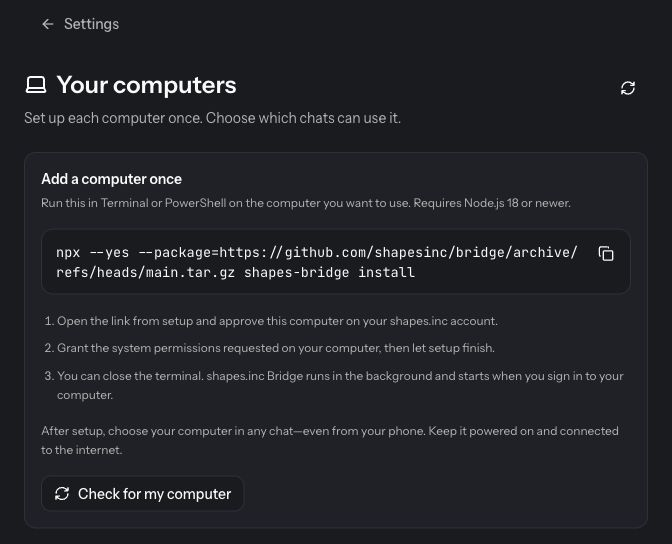

# shapes.inc documentation

Source for [docs.shapes.inc](https://docs.shapes.inc), the help site for shapes.inc. It is a [Mintlify](https://mintlify.com/) MDX site: pages are `.mdx` files, `docs.json` owns navigation and site metadata, and there is no application code, package manifest, or test suite in this repository. Merges to `main` publish the site.

Read [AGENTS.md](AGENTS.md) (terminology, positioning, feature-reference rules) and [architecture/DOCUMENTATION.md](architecture/DOCUMENTATION.md) (content structure, validation, dated handoff notes) before editing. This file only tells you how the repository works.

## Layout

```
docs.json                   navigation, metadata, redirects, theme
*.mdx                       guides (Docs tab)
faq.mdx, faq/*.mdx          FAQ index and answers (FAQ tab)
articles/*.mdx              longer articles (Articles tab)
images/                     screenshots and site images, served at /images/...
images/october-2026/        current signed-in UI captures, dated -YYYYMMDD.jpg
logo/, favicon.png          site logo (light/dark) and favicon
AGENTS.md                   rules for people and agents writing these docs
architecture/DOCUMENTATION.md   content architecture, validation, verification log
```

Entry points: `introduction.mdx` is the landing page, `features.mdx` indexes capabilities and their canonical guides, `docs-for-agents.mdx` explains the Markdown exports (`llms.txt`, `llms-full.txt`, `<page>.md`, the `/mcp` endpoint) that AI agents read.

## Local preview

The repository's own instructions use the `mint` CLI.

```bash
npm i -g mint
mint dev --no-open
```

`mint dev` renders the site locally. It does not serve the public `.md` and `llms.txt` aliases or live search; verify those on the deployed site after a merge. The local `/_markdown/<slug>` route shows the Markdown an agent would receive for a page.

## Pages

Every page has YAML frontmatter with `title` and `description`. Most also set `keywords` (an array) and `sidebarTitle`. Retired routes that stay on disk for old links set `noindex: true` and `hidden: true` and point readers to the current guide.

**Add a page**

1. Create `kebab-case.mdx` in the root, `faq/`, or `articles/` with frontmatter.
2. Add its path (no extension) to the right group in `docs.json`.
3. If it documents a feature, link it from `features.mdx` and, where relevant, `docs-for-agents.mdx` and `faq.mdx`.

**Edit a page**

Keep the route and existing heading anchors; other pages, the FAQ index, and the deployed Help flow link to them. Update `title`, `description`, `keywords`, cards, and navigation together with the body so search and social previews match.

**Remove or retire a page**

Prefer retiring: keep the file, add `noindex: true` and `hidden: true`, remove it from `docs.json`, and replace the body with a pointer to the current guide. Content that must leave the page but stay in source goes inside `<Visibility for="humans">` wrapping a dated MDX comment, which keeps it out of both the rendered page and the agent Markdown export. If a route must move, add an entry to `redirects` in `docs.json` (example: `/completed` -> `/archive`). Fix every internal link to the old path.

**Images**

Put new captures in a dated or topic folder under `images/` (current practice: `images/october-2026/<control>-YYYYMMDD.jpg`, cropped to the relevant controls, no chat lists, invite links, identities, or payment details). Embed with a caption and alt text:

```mdx
<Frame caption="Settings → Computers has the install command.">
  
</Frame>
```

Every illustrated step also needs written instructions. Replace or retire screenshots that show labels the product no longer uses. Re-captured images get a new filename so caches do not serve the old one.

## docs.json

`docs.json` follows the Mintlify `docs.json` schema (`"theme": "mint"`). It holds the site name, colors, logo, favicon, Lexend font, navbar (Support link to `talk.shapes.inc/help`, **New chat** button to `talk.shapes.inc`), footer, Open Graph tags, one redirect, and the navigation.

Navigation is three tabs. Counts as of the last change to this file:

| Tab | Groups | Pages |
| --- | --- | --- |
| Docs | Getting Started, Do Things Together, Get Things Done, Chats & Collaboration, Build & Configure Assistants, AI Engines, Prompts & Memory, Credits & Products | 75 |
| FAQ | FAQ | 44 |
| Articles | Multiplayer Assistants, Practical Guides | 11 |

Every navigation entry must exist on disk; `mint validate` and `mint broken-links` catch missing pages. Keep existing page paths stable, including older slugs, so external links keep working.

## Content rules

Short version of [AGENTS.md](AGENTS.md) and [architecture/DOCUMENTATION.md](architecture/DOCUMENTATION.md); those files win.

- The product is **shapes.inc**, always lowercase with the dot. An individual AI is a **shape**; **shapes** is only the plural of those participants. The conversation is a **chat** or **group chat**.
- Positioning comes from the talk.shapes.inc homepage: "Do things with your friends." Shapes are group assistants for anything you do with other people. **New chat** is the primary action; making a shape is optional.
- Use the labels readers see in the deployed product. Do not infer labels from source identifiers, old screenshots, or database fields. If you cannot verify a control, describe the task without naming it.
- Describe what people can actually do today, with the access and usage limits that apply. Do not promise automatic app access, perfect memory, unlimited usage, or features that depend on unconfigured skills. Prices and allowances are written in credits.
- Public discovery catalogs (Featured, tags, browse/search) are gone and aren't coming back; do not recommend them. Keep direct shape links and existing chats.
- Each feature guide covers purpose, setup, limits, how to tell it finished, and recovery. Keep one canonical explanation and link to it from overviews instead of copying limits around.
- Changing anything a shape reads as instructions (prompts, preset examples) needs explicit authorization; copy fixes do not change behavior.
- Keep fundraising, projections, hiring plans, usage numbers, and other internal material out of public pages. Record them in the PR or the architecture handoff instead.

## Before opening a PR

From the validation section of `architecture/DOCUMENTATION.md`:

1. Check terminology and labels against the deployed UI, including metadata, navigation, image text, and link labels.
2. Confirm `docs.json` parses and every navigation page exists.
3. Run the Mintlify checks and separate pre-existing failures from new ones:

   ```bash
   mint validate
   mint broken-links --check-anchors
   ```

4. Preview with `mint dev --no-open` and look at every changed route on desktop and at a phone width (recent passes used 375px or 390px) for broken images and horizontal overflow.
5. Review the diff for terminology, preserved troubleshooting, valid MDX, and unsupported feature claims. Escape `$` in MDX when a paragraph has two amounts.
6. In the PR, state which product source revisions you checked against and what was not verified live. Add a dated section to `architecture/DOCUMENTATION.md` for changes that future editors need to know about; the file is additive.

## Deployment

A merged PR to `main` publishes the site; the PR itself does not. There is no build or deploy workflow in this repository. After publication, confirm the public `.md` pages, `llms.txt`, and search reflect the change before telling anyone they do.

## Contacts

- Site: https://docs.shapes.inc
- Product support: https://talk.shapes.inc/help or hi@shapes.inc
- Documentation problems: open an issue or PR in this repository.
