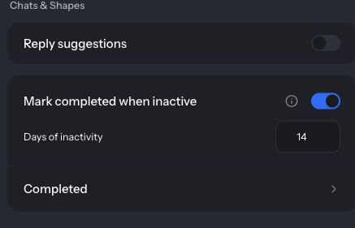

Archive keeps your sidebar focused on the plans and projects that are still moving. When the trip is booked or the assignment is turned in, the chat moves out of your list on its own, and it's one tap away when you need it again.

Nothing in Archive is deleted. The chat, its messages, and its members stay exactly as they were.

## How automatic archiving works

- A chat or Shape you haven't used for the **Days of inactivity** period moves to Archive. The default is 14 days.
- Archiving a shared chat only changes your own list. Everyone else still sees it as usual.
- A new message in an archived chat brings it back to your list.
- Archived chats pause watches and scheduled checks until you unarchive them. See [Tasks](/tasks).
- Archived Shapes stay out of Shape pickers. They still appear in **Settings** → **Your shapes** with an **Archived** tag.

## Archive a chat yourself

Finished with a chat before the inactivity period is up? Archive it now:

- **In the chat:** open **More actions** (⋯) → **Archive**.
- **In the sidebar:** open the ⋯ next to the chat → **Archive**. On touch devices, swipe the chat to show ⋯.

A "Chat archived" message appears with **Undo**. A chat you archive yourself stays in Archive until there's new activity in it or you restore it.

## Unarchive or restore

<Tabs>
  <Tab title="From the chat or sidebar">
    - Open the archived chat and choose **More actions** (⋯) → **Unarchive**.
    - Search the sidebar for the chat. Archived chats show an **Archived** label and a **Restore** button.
    - When you have archived chats, the bottom of the sidebar shows **Looking for something? Check Archive**. Select **Check Archive** to open the full list.
  </Tab>
  <Tab title="From Settings">
    1. Open **Settings** and select **Archive** under **Chats & agents**.
    2. Choose the **Chats** or **Shapes** tab.
    3. Use **Search archive** to find something by name.
    4. Select **Restore** next to an item. To restore several, check them and select **Restore selected**, or select **Restore all** and confirm with **Restore**.

    When you've typed a search, **Select all** and **Restore all** become **Select results** and **Restore results**, so you only restore what matches.
  </Tab>
  <Tab title="Shapes">
    - In **Settings** → **Your shapes**, archived Shapes show an **Archived** tag. Select **Restore** to bring one back.
    - Or open **Settings** → **Archive** → **Shapes** and restore it there.

    Restored Shapes can show up in Shape pickers again.
  </Tab>
</Tabs>

## Change the period or turn archiving off

1. Open **Settings** → **Personalization**.
2. Under **Chats & Shapes**, set **Days of inactivity** to any whole number from 1 to 365.
3. To stop automatic archiving, turn off **Archive when inactive**.

  

    
    
  

  
Use Archive when inactive and Days of inactivity to control automatic archiving. Tap the image to open it at full size.

Turning it off brings automatically archived chats and Shapes back to your list. Items you archived yourself stay in Archive until there's new activity or you restore them. Turning it back on uses each item's existing activity dates, so anything already inactive for longer than the period moves to Archive again.

## Troubleshooting: "My chat disappeared"

<AccordionGroup>
  <Accordion title="Check Archive first">
    Most missing chats were archived after a quiet stretch. Search the sidebar for the chat's name, select **Check Archive** at the bottom of the sidebar, or open **Settings** → **Archive**. Then **Restore** it, or just send a message in it.
  </Accordion>
  <Accordion title="Check the sidebar filter">
    If **Unread**, **DMs**, **Social**, or **Private** is selected at the top of the sidebar, select **All**. The **DMs**, **Social**, and **Private** filters only appear when you have more than 50 chats.
  </Accordion>
  <Accordion title="Check your workspace">
    The sidebar shows the chats in your current workspace. If you use workspaces, switch to the one the chat belongs to.
  </Accordion>
  <Accordion title="You left the chat">
    After you leave a chat, you need an invite link to rejoin. Ask someone in the chat to send you one.
  </Accordion>
  <Accordion title="The chat was deleted">
    Right after a chat is deleted, a "Chat deleted" message offers **Undo**. Archiving a chat never deletes it. If you still can't find it, ask in [Help Me](https://talk.shapes.inc/help) with the chat's name and roughly when you last used it.
  </Accordion>
</AccordionGroup>

## Related

- [Where did my chat go?](/faq/where-did-my-chat-go)
- [Settings and Personalization](/personalization)
- [How to organize your sidebar](/sidebar-organization)
- [How do I delete a chat?](/faq/how-do-i-delete-a-chat)
