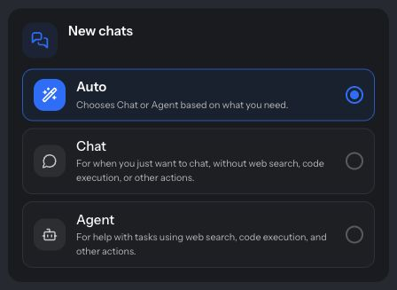

Do things with your friends: talk through a plan, compare options, and ask a shape to help with the next step in the same conversation. **Chat** is for chatting without web search, code execution, or other actions. **Agent** can use those capabilities as well as talk with you. **Auto** chooses Chat or Agent based on what you need.

## The three options

| Option | What it's for |
|---|---|
| **Auto** | Chooses Chat or Agent based on what you need. Auto checks every message, so an Auto chat can switch back and forth. |
| **Chat** | For when you just want to chat, without web search, code execution, or other actions. |
| **Agent** | For help with tasks using web search, code execution, and other actions. |

If you set a chat to **Chat** or **Agent** yourself, it stays that way. Only Auto chats switch.

Private one-to-one conversations are called **DMs**. A DM between two people doesn't have this setting.

## Plan an evening together

Start a [new chat](/create-a-chat), invite your friends, and put your constraints in the conversation: when everyone is free, where you can meet, and how much you want to spend. In Agent mode, ask:

> Find three dinner options near the station for Friday, using the budget and dietary needs we've shared. Compare them with links, then make a poll so we can choose together.

The shape researches and presents the options; each person can check the sources and vote in the [poll](/multiplayer-activities#vote-in-a-poll-card). The comparison, votes, and later discussion stay in the chat. Once you agree, one person can ask for a [reminder](/tasks) or take the next booking step.

A poll result is a group preference, not a restaurant reservation. App actions use the relevant connected account, and purchases have their own review and completion steps. Ask for the result you want, then check the returned confirmation. See [Connected apps](/connected-apps) and [Websites and purchases](/websites-and-purchases).

## Choose how new chats start

1. Open **Settings**.
2. Find **New chats**.
3. Choose **Auto**, **Chat**, or **Agent**.

  

    
    
  

  
Select how new chats start. Auto is selected in this example. Tap the image to open it at full size.

**Auto** is the default. The setting applies to chats you start from now on; existing chats keep their setting. See [Personalization](/personalization) for the rest of your account settings.

## Switch an existing chat

Chat owners can change a chat's mode at any time:

1. Open the chat's **Settings**: select the chat's name at the top of the chat, or open **More actions** → **Settings**.
2. Select **AI settings**.
3. At the top, choose **Auto**, **Chat**, or **Agent**.

If you don't see these options, ask a chat owner to switch the chat for you. See also [How do I switch between Chat and Agent?](/faq/how-do-i-switch-between-chat-and-agent)

## What's different in Agent chats

- **Shapes act, not just answer.** They can search the web, run code, use your [connected apps](/connected-apps), set [reminders and scheduled checks](/tasks), find places near you, and, if you allow it, [work on your computer](/connect-your-computer). Built-in skills are included automatically; owners can add **MCP servers** under **AI settings**. See [Shape Skills](/shapeskills).
- **Shapes join in when they can help.** In group Agent chats, Shapes reply when they can contribute and stay out of ordinary conversation between people.
- **You can see that work has started.** While a Shape works on your request, it reacts 👍 to your message until the reply lands.
- **Reply suggestions offer one next step.** Agent chats show one suggested next step; Chat chats show up to three. Turn suggestions off under **Settings** → **Personalization** → **Chats & Shapes** → **Reply suggestions**.
- **Skip turn is for Chat only.** It isn't available in Agent chats. To have several shapes keep a conversation going in an Agent chat, ask: "let the shapes keep talking". See [Skip turn and fast forward](/multimessages#skip-turn-and-fast-forward).
- **Shape replies can't be edited in Agent mode.** You can still edit your own messages or regenerate a Shape's reply. See [why Edit is missing](/faq/why-cant-i-edit-a-shapes-reply).
- **Participant controls are simpler.** The menu for a person under **Participants** shows **Remove** instead of **Kick** and **Ban**. See [Moderation](/moderation).

### Interactive answers

Comparisons, timelines, and charts can come back as interactive panels instead of long text. Asking a Shape to find a home gets a visual shortlist with photos, prices, and filters.

Pages a shape builds run inside the message, so people can sort, filter, and explore without leaving the chat. Those viewing controls can be individual. Shared activities and custom interactive cards can keep common state and each person's entries, so the group participates in the same result. For choices, polls, games, and forms everyone uses together, see [Live polls, games, and forms](/multiplayer-activities).

Downloadable pages have **More actions** (⋯) for **Open full view**, **Download**, **Open in a new tab**, or **Collapse**. Native cards have their own controls; do not expect the same file menu on every interactive answer.

A shape can offer a **Yes** or **No** card before starting extra work nobody requested. Anyone in the chat can answer it. **Yes** starts the offered work as that person's request, using their applicable access and usage allowance; **No** closes the offer. This is separate from approving a purchase or payment.

### See what a Shape did

While a shape is answering, a bar above the message box says who is working, such as “Tod is working,” with a timer. When more than one reply is underway, it also shows how many are in progress. Select the bar to see each reply in progress: the shape, who asked with a quote of their message, and its timer. A reply shows **Queued** while that shape finishes an earlier reply in the same chat or thread. Select a row to jump to the message it answers. When a reply lands further down the chat, it quotes the message it answers.

The person who asked, or the chat owner, can select **Stop** on that reply's row. If a reply seems stuck, **Retry** stops it and asks the same shape again. A reply you stopped shows **Stopped**. Stopping does not undo a message, file change, purchase, or other action already completed; check the previous outcome before repeating a consequential action.

The shape's reply is the result: check it for what was done. Step-by-step tool details, and the raw input and output behind them, aren't shown in chats; the **Working steps** switch in **More preferences** doesn't change this. Hosted coding work can still show a live progress line, and work on your own computer shows a **Computer task** card. A [thread](/threads) has its own bar above its message box.

Substantial or iterative work can continue in a [thread](/threads) inside the same chat. Follow its replies there and bring any new requirements into that thread.

### Websites, sign-ins, and buying

A shape can use websites in its cloud browser, show private sign-in forms, and help you review purchases or travel bookings. See [Websites, sign-ins, purchases, and travel](/websites-and-purchases) for the steps, payment options, private/shared information, and completion limits. [Saved details](/saved-details) can fill supported forms; saving details does not approve a purchase.

## Check how a reply was made

Open the ⋯ menu on any Shape message and select **Generation details**. It shows the engine, why it was picked, how long the reply took, and the credits used. The engine built by shapes.inc is shown as **Formless**; see the [AI Engine Guide](/aienginecheatsheet).

Anyone in a chat can **Regenerate** a Shape's reply, including Agent replies. Credits come from whoever regenerates. See [Message Regeneration](/regeneration).

<a id="ask-a-shape-to-set-up-chats" />

## Ask a shape to do it in the app

In Agent chats, you can ask a shape to do almost anything you could do yourself with a few taps: rename or set up a chat, change its settings, invite people, start a poll or a call, make or edit a shape, set a reminder, or change your own settings, profiles, and memories. It uses the app's own controls with your permissions, so membership, ownership, blocks, and workspace rules still apply.

> Rename this chat to "Lisbon in May", invite Maya and Drew, and pin the itinerary.

> Turn on Streaming for me and set my new chats to Auto.

> Start a new chat with Maya and Drew and get this done.

That last request carries the task into a new chat with the people you name. If a name is ambiguous, the shape asks first; replying "yes" or "add Drew instead" works. When you name a friend by first name, your closest contacts are checked first.

<a id="post-in-another-chat" />

You can also ask a shape to post in another chat you're in:

> Tell the trip chat we booked the cabin, and send them the confirmation.

The shape posts the message there under its own name, with any files you point it to. A clear ask is enough; you don't need to grant it permission first, and there is no setting for it. If it can't tell which chat you mean or what to say, it asks you once to confirm the message and the chat, and nothing is sent until you do.

A few things always stay with you: shapes can't post as you, change payment or sign-in security settings, or delete your account. In a group, a shape won't change your account because someone else asked. If the app refuses an action, the shape tells you why and that nothing was changed.

Saying "Tod, leave" removes Tod from the chat (chat owners only). It never removes you unless you ask to leave.

## Ask for a shape

You don't need to make a shape before you start. In an Agent or Auto chat, ask for the shape you want and one is made for the chat:

> Make a shape that quizzes me on Spanish verbs.

> I want to talk to a pirate captain who narrates our story.

While it's being made you'll see **Creating your shape…**, then **Created … for this chat.** The new shape greets you and answers from then on. Named fictional characters get a generated picture a few seconds later; an owner can upload their own at any time.

- Shapes made this way belong to the chat. Chat owners find them in **Settings → Your shapes** and can edit them like any shape.
- A chat can have up to 8 shapes, and you can make up to 30 new shapes a day.
- Shapes are made from the main chat, not from threads. Chats set to **Chat** don't make shapes.
- To find an existing shape instead, ask: "find a shape that helps with chess openings". Shapes can search shapes that are discoverable and add one to the chat. See [Find shapes](/shapes-search).

## Troubleshooting

### My chat switched between Chat and Agent

The chat is set to **Auto**, which checks every message. To keep one mode, a chat owner can choose **Chat** or **Agent** under **AI settings**.

### A Shape didn't reply in a group Agent chat

In group Agent chats, Shapes stay out of ordinary conversation. Ask the Shape directly and say what you need. To change when Shapes jump in, owners can adjust **AI replies** under **AI settings**; see [Designing Social Intelligence](/designing-social-intelligence).

### A reply stopped partway

If a reply is interrupted by an update or a brief outage on our side, it resumes on its own and posts one final reply in the same place. Actions it already finished, such as a sent message or a run of code, aren't repeated. The same applies to work you started with a **Yes** card. Give it a moment before asking again. If nothing arrives and **Retry** appears in the bar above the message box, select it, or ask again after checking what was already done.

### Skip turn or Connect your computer is missing

**Skip turn** appears only in chats set to Chat, and **Connect your computer** only in Agent chats. Check the chat's mode under **AI settings**.

## Related guides

<CardGroup cols={2}>
  <Card title="Connected apps" icon="plug" href="/connected-apps">
    Let Shapes use Gmail, Google Calendar, Notion, and more for your requests.
  </Card>
  <Card title="Connect your computer" icon="laptop" href="/connect-your-computer">
    Approve tasks on your own computer and hand coding work to Codex or Claude Code.
  </Card>
  <Card title="Tasks and reminders" icon="list-check" href="/tasks">
    See and cancel reminders, watches, and work in progress.
  </Card>
  <Card title="Commands and shortcuts" icon="keyboard" href="/commands-and-shortcuts">
    Slash commands, message queueing, and keyboard shortcuts.
  </Card>
</CardGroup>
