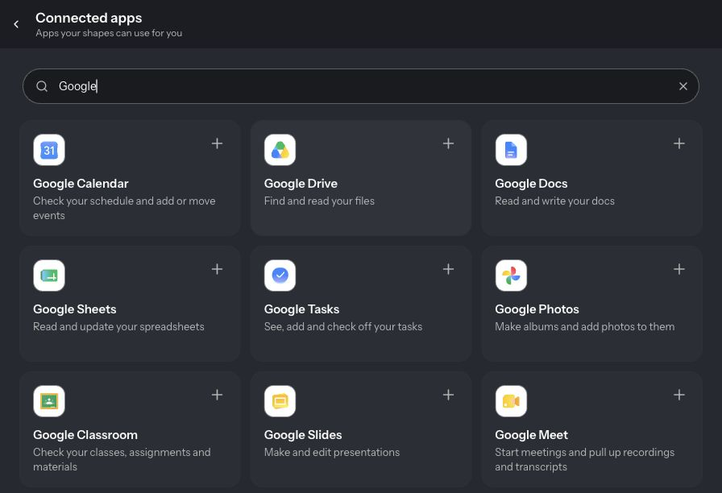

Group plans often depend on things that live in your own apps: the calendar that shows when you're free, the doc with the venue quotes, the email thread with the landlord. Connected apps let a Shape work with those accounts when you ask, so it can check, find, and draft things for the group instead of you copying them in.

Personal connections belong to you. Shapes use them for your requests in [Agent chats](/chat-and-agent-modes), including later runs of watches or tasks you authorized. A clear request can authorize an action, such as sending a specific message; the shape asks when important details are missing or a service requires approval.

## Open Connected apps

- Open **Settings** → **Connected apps**, or
- In a chat, open the composer's **+** menu → **Connected apps**.

Both open the same page: a directory of every app you can connect.

<Frame caption="Search Connected apps to find the service you need, then open it to review its capabilities and connect.">
  
</Frame>

## Connect an app

1. Search for an app, or browse the sections: **Popular**, then categories such as Email & calendar, Docs & files, Tasks & projects, and Developers. Select **See all** to open a whole section.
2. Select an app to see what Shapes can do with it. Open **Examples** for sample requests.
3. Select **Connect** followed by the app's name, for example **Connect Gmail**.
4. Sign in to the app and allow every permission it asks for.
5. Select **Done**.

Use **All apps** and **Connected** at the top to switch between the full directory and the apps you've connected. An app you've connected shows **Connected**, or **Connected · 2 accounts** when it has more than one. **Shared access** shows which teammates can have shapes use your apps, and whose apps you can use. See [Let teammates use your apps](#let-teammates-use-your-apps).

### Try an example

Select an example, such as the one on a Popular app's card or under **Examples**, to draft it in a new chat. The request waits in the message box with the app mentioned, and nothing is sent until you send it. If the app isn't connected yet, a prompt above the message box lets you connect it first.

## Use more than one account

You can connect up to 10 accounts per app, for example a personal and a work Gmail.

1. Open the app, find **Accounts**, and select **Show**.
2. Select **Add another** followed by the app's name, for example **Add another Gmail account**, and sign in.
3. Use the ⋯ menu on an account to **Rename** it with a nickname such as "Work", **Make default**, or **Remove** it.

Shapes use the default account unless you name another one in the chat:

> Use my Work Gmail to find the caterer's last invoice.

When a Shape tells you which account it used, it refers to it by nickname, never by email.

## Make an app read-only

Turn on **Read-only** for an app when you want shapes to look but never change anything.

1. Open **Settings** → **Connected apps** and open the app.
2. Turn on **Read-only**, for example on Gmail: "Shapes can read and search Gmail, but can't send, create, change or delete anything."

The app then shows **Read-only** next to **Connected**. Shapes can still read, search, and download from it, but every send, create, change, and delete is refused before it runs, in every chat, including scheduled tasks and watches.

- It covers every account of that app, including accounts you add or reconnect later.
- You can turn it on before you connect, so "connect my Gmail, but read-only" holds from the first sign-in.
- Each Google app has its own switch, so Drive can be read-only while Calendar can still add events.
- You can ask a shape instead: "make my Gmail and Calendar read-only." Only your own request turns it off again; a request it blocks, such as "email Sam", doesn't.
- An app you [share with a chat](#share-an-app-with-a-chat) follows your setting for everyone using it there.
- MCP servers, and apps connected through them, aren't covered.

## Use apps in a chat

You can ask in plain words ("Check my calendar for Saturday and suggest two times"), or mention the app directly:

- In an Agent chat, type **@** and pick an app from the **Apps** section, such as Gmail, Google Calendar, Notion, or Google Drive.
- Each app shows whether it's **Connected**, **Not connected yet**, **Needs reconnecting**, or **Needs permission**.
- If you mention an app in an empty message box, an example request is filled in. Type over it with your own request.

App mentions are available in Agent chats when you're signed in. They aren't offered in threads or in DMs between people.

### Connect cards

When a shape needs an app you haven't connected, a **Connect** card for that app appears in the chat. For a personal connection, only the person asked to connect can sign in for their account. Select **Connect** and sign in. The shape picks the task back up after you connect, without you sending another message. If a request needs two apps, it carries on once both are connected, without asking again or redoing what it already did.

If an app is missing a permission, the card says the app needs permission and shows **Reconnect**. Reconnect and allow every permission it asks for.

## Share an app with a chat

Some work apps support a separate connection for a group: Linear, Notion, Jira, Asana, ClickUp, Airtable, Trello, Confluence, Monday, and Devin. When **Share with a chat…** is offered in an app's details, it connects an account for the selected chat. A chat's connect card may also offer **Connect for this chat**, alongside **Just for me** for the personal connection. Sharing lets eligible members use that account in the selected chat; it does not turn all your personal connections into shared accounts. Gmail, personal calendars, and GitHub do not support this sharing option.

Shared connections appear under **Shared with chats** in Connected apps. The person who connected the account can use **Manage chats** to change where it is shared, or **Stop sharing everywhere** to disconnect that shared sign-in. Access depends on both the requester and the person sharing still having access to the chat, and on the connection remaining active. Sharing pauses in a chat if the person who connected the account leaves it.

<a id="share-devin-with-a-chat" />

### Share Devin with a chat

In an Agent chat, ask a shape to connect Devin and choose **Connect for this chat**. The sign-in page asks for a Devin API key; use a service-user key for your Devin organization. Everyone in the chat can then ask shapes to start Devin sessions, follow them, and search past ones on that connection. A few things to know before you share it:

- Sessions run on the Devin plan of the person who shared it, with no separate limit per member or per chat.
- Members can see and continue any session that key can reach, not only ones started from this chat.
- Only the person who shared it can change Devin's knowledge, playbooks, schedules, and other admin settings through shapes.

## Use apps together

### Find a time for a study group

1. Each person who wants their calendar checked connects their own calendar and asks the shape for their availability in the group chat. Others can simply type the times they are free.
2. Ask the shape to compare the availability people have shared and suggest a time. Connecting your calendar does not let another member inspect it; the availability you post is visible in the chat.
3. After the group chooses, one person can explicitly ask the shape to add the event to that person's connected calendar, naming the time and intended invitees. Check the created event and its details in the calendar; a suggested time or drafted invitation is not a saved event.

### Keep a project plan in a shared app

If **Share with a chat…** is available, Maya can connect Notion for the project's chat. Drew can ask the shape to summarize the agreed planning page; another member can ask it to update the page with the group's chosen date. The requests use that shared connection, while each person's other accounts remain separate.

Ask the shape to put the summary and a link to the updated page in the chat so everyone can review the same result. Check the page itself after an edit. Only Maya manages where that connection is shared; a chat member's ability to request work does not make them the connection owner.

## Have a shape send email

In an [Agent chat](/chat-and-agent-modes), a shape can send real email from its own address, such as tod@shapesmail.com. You don't need to connect anything.

- **To an address:** "email the hotel at frontdesk@example.com and ask about late check-in."
- **To someone on shapes.inc:** "email Maya the itinerary." It goes to the address on their account; the shape never sees it. If they have no account email, the email in their [Saved details](/saved-details) is used, still hidden.
- **To you:** "email me the packing list."
- **Several people and cc:** "email Maya and Drew, cc Sam." Everyone on the email sees each other's address in To and Cc.
- **Later or by phone:** a scheduled email, or one you ask for [on a call](/phone-calls#on-a-call-with-you), works the same way.

Replies come back into the chat that sent the email, so everyone in it can read them. Ask "did the hotel reply?" from another chat and the shape can find it if you sent the email or are in that chat.

To send from your own Gmail instead, say "as me" or "from my email". That uses your connected Gmail.

### Review a draft before it goes

Ask for a draft ("draft a reply, I want to check it first") and the shape shows the exact words with a **Send** button. Anyone in the chat can tap **Send**, and that sends exactly those words.

When a shape writes an email in its own words for you, such as a reply or a thank-you, it first reads a few emails you've sent from your connected Gmail and matches your greeting, sign-off, length, and tone. If it can't find any, it says so instead of guessing a style.

### Ask before sending

A direct request like "email Sam that I'm running late" is the go-ahead, and the shape sends it. Paying, booking, and deleting still ask first.

To always review first, tell a shape something like "never send an email without asking me." That rule is saved, and every email or message is held until you approve it:

- Approve the draft, or say "skip review this time", to let one email go. The next one asks again.
- "Send now" on its own doesn't skip review.
- A message you wrote word for word, with who it's to and "send it now", goes straight out.

## Share links and files

Share a public Google Docs, Sheets, Slides, or Drive link in a chat and Shapes can read it, look at its images, and send you the file. Files from connected apps like Notion work the same way.

## Find more apps

- **From marketplaces**, on the Connected apps page, lists apps from public app directories. Select one to see its directory and service, then select **Connect**.
- In Agent chats, Shapes can find and connect more apps from the public MCP directory and WebMCP. A Connect card appears in the chat, and the task continues after you connect.
- Chat owners can add an MCP server for a whole chat under the chat's **Settings** → **AI settings** → **MCP servers**. See [Shape Skills](/shapeskills#connect-an-outside-service).

<a id="check-before-replying" />

### Check a chat's MCP server before every reply

A chat owner can have every shape in the chat search one of its MCP servers before answering, for example a team's docs or knowledge base.

1. Open the chat's **Settings** → **AI settings** → **MCP servers**.
2. Select **Add MCP server**, or edit a server you've added.
3. Turn on **Check before replying** and save.

The server's row then shows **· Checked before replying**. It's off by default, and it's offered only for servers members don't each need to sign in to.

<a id="let-a-shape-keep-an-eye-on-gmail-or-github" />

## Let a Shape keep an eye on Gmail, Calendar, or GitHub

Ask a shape to watch a specific update in your connected Gmail or GitHub. Choose the chat where you want its updates; in a shared chat, other members can read what it posts. A broader request to keep an eye out for anything that needs you uses a private chat with the shape, and also reads your calendar for flights.

> Keep an eye on my Gmail and tell me only when something needs a reply from me.

After you connect Gmail, Calendar, or GitHub, a shape offers this once. "Watch my inbox" keeps calendar and GitHub on too, unless you say "only my email". Say stop at any time. For what the sweep posts, drafts, and holds back, see [Keep an eye out for anything that needs you](/tasks#keep-an-eye-out).

## Disconnect an app

1. On the Connected apps page, open the app's ⋯ menu, or open the app.
2. Select **Disconnect** and confirm.

Once disconnection completes, shapes stop using that app's accounts in every chat. Disconnecting removes every account for the app; to remove only one, use **Remove** on that account. To change only where a shared connection is available, use **Manage chats** under **Shared with chats**. For Google apps, the confirmation also links to your Google account permissions so you can remove access there too. Each Google app disconnects on its own: disconnecting Gmail leaves Calendar and Drive connected.

Asking a shape how to disconnect, or what happens if you do, gets an answer; it doesn't disconnect or delete anything. To stop shapes changing things without disconnecting, [make the app read-only](#make-an-app-read-only).

## Let teammates use your apps

In a group chat, a shape can use a member's connected app for a teammate's request when the request names that member. The member has to be in the chat. What it may do depends on the access the member gave that teammate.

Open **Settings → Connected apps → Shared access** to see this, grouped by chat:

- **Your apps** lists who can have shapes use your apps, with a note such as how often it was used and when, or **Set by you**.
- **Others' apps you can use** lists what you can ask for.

For each person in each chat, choose:

| Option | What shapes can do for that person |
|---|---|
| **Automatic** | Routine work only: reading, searching, drafting something unsent, or a small edit. Anything more asks you in the chat. |
| **Ask me first** | Nothing until you say yes in the chat. |
| **Read** | Read and search, until you change it. |
| **Read and edit** | Read, search, and make changes, but not send. |
| **Read, edit and send** | Also send messages and email. |
| **Off** | Nothing. |

Reading never allows edits, and editing never allows sending. No option covers paying, bookings, deleting, archiving, publishing, or changing who has access: those always need you to say yes in the chat.

You can also set it by telling a shape, for example "if Drew asks, let him use my Notion", or "don't use my apps for anyone here", which sets that person to **Ask me first**. Your choice is saved for later requests. An app that's [read-only](#make-an-app-read-only) stays read-only whatever you choose here.

## Privacy and trust

- **Personal accounts stay yours.** Your personal connection is used for your requests and authorized scheduled work. Other members don't gain it by joining the chat; routine help for a teammate follows your **Shared access** settings.
- **Say what action you want.** Examples open as drafts. Specify whether you want a draft or an action completed; an explicit request can authorize the action without a second confirmation. Check the returned result. To review every send first, set an [ask-first rule](#ask-before-sending).
- **Limit an app to reading.** Turn on [Read-only](#make-an-app-read-only) and nothing in that app is sent, created, changed, or deleted, from any chat or scheduled task.
- **Account details stay hidden.** Account emails show only when you open **Accounts**, and Shapes refer to accounts by nickname.

## Troubleshooting

### An app says Needs reconnecting or Needs permission

Open the app and select **Reconnect**, then allow every permission the app asks for.

### I can't mention an app with @

App mentions work in Agent chats when you're signed in, but not in threads or DMs between people. Check the chat's mode in [Chat, Agent, and Auto](/chat-and-agent-modes).

### The Shape used the wrong account

Name the account by its nickname in your request, or open the app's **Accounts** and choose **Make default** on the account you use most.

### Reddit isn't listed

Reddit is closing its public Data API and no longer issues app access, so Reddit was removed from Connected apps on November 1, 2026. See [Why can't I connect Reddit?](/faq/why-cant-i-connect-reddit). Reddit Ads is a separate API and still connects.

### Sign-in didn't finish

Select **Connect** or **Reconnect** again and complete the sign-in. If it keeps failing, ask in [Help](/feedback) and include the app's name.
