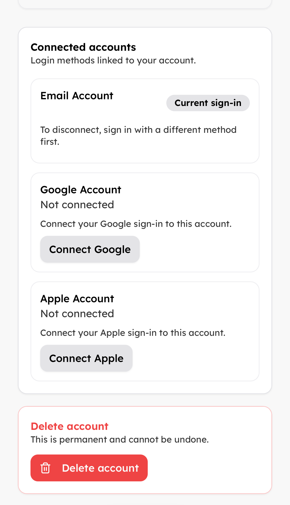

Open **Settings**, select your name or picture at the top of the settings list, and tap **Delete account** at the bottom of the page. If you aren't in the app, open [shapes.inc](https://shapes.inc) or [talk.shapes.inc](https://talk.shapes.inc) and sign in first.

On a phone, **Settings** is in the bottom navigation. On a computer, select **Settings** in the sidebar.

The **Delete account** card is at the bottom of the page, below **Connected accounts**.

  

shapes.inc asks you to read a warning, tap **Continue**, type your username, and confirm with **Delete Account**. A 30-second countdown then starts. You can still tap **Cancel** before the countdown finishes.

- **What happens when you delete your account:**
  - **This action is permanent once the countdown finishes.**
  - Shapes and messages you created remain unless you delete them first.
  - Chats you created remain unless you delete them first.
  - Your account is queued for permanent deletion and cannot be recovered.
  - You cannot sign up again with the same email.
  - The process can take up to 48 hours.

<Tip>
  If you want to save content before deleting your account, read the [export and backup limitations](/faq/can-i-export-or-back-up-my-data). There is currently no official full export tool.
</Tip>

<Tip>
  Need more help? Ask in [Help Me](https://talk.shapes.inc/help).
</Tip>

[Back to FAQ](/faq)
