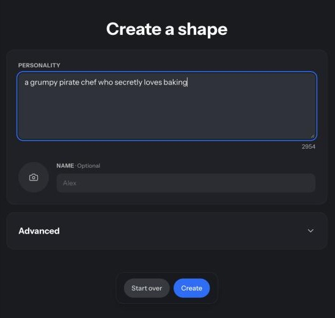

Open **Settings** → **Your shapes** and select **New shape**. Sign in first if needed. Creating a shape is optional; you can start with [New chat](/create-a-chat) instead. Give the shape a clear role, such as helping your group research options or review plans.

On **Create a shape**, type the shape's **Personality**: who it is and how it should respond. That is the only required field.

  

    
    
  

  
Fill in Personality, then select Create. Tap the image to open it at full size.

Everything else is optional:

1. **Name**. Leave it blank and the shape gets one that fits.
2. A picture. Skip it and one is made for the shape; it appears in the chat a few seconds after you create it.
3. **Advanced**, for options such as **Response style** and **Initial message**. Anything left blank is written for the shape, and nothing you typed is rewritten.

Tap **Create**. Writing the shape's profile takes about 10 seconds, then its chat opens with a greeting. **Start over** clears the form.

Your new shape appears in **Settings** → **Your shapes**, where you can edit it later. Creating your first shape doesn't send an automatic helper DM. For the full editor, see [Build an assistant](/how-to-make-a-shape).

For anything else, ask Tod in [Help Me](https://talk.shapes.inc/help).
