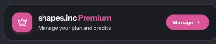

Gift cards can't be purchased right now, and the Premium page has no gift card options or **Redeem Gift Card** control. A gift card redeemed earlier stays on your account as billing credit toward eligible shapes.inc purchases.

<Info>
  The earlier purchase steps are retired. See [How to Purchase a shapes.inc Gift Card](/purchasegiftcards).
</Info>

To open the Premium page, go to **Settings** → **Premium** under **Account**. It shows monthly plans only. If you hold a gift card code you haven't redeemed, email [hi@shapes.inc](mailto:hi@shapes.inc). Don't post the code in a public chat.

<Visibility for="humans">
{/* October 26, 2026: Premium now opens from an Account row in Settings. Keep the obsolete card capture in source; the Visibility wrapper excludes this comment from agent Markdown.

  

    
    
  

  
Select the Premium card in Settings. Your button may say Go Premium or Manage. Tap the image to open it at full size.

*/}
</Visibility>

### **Important Details About Purchasing Gift Cards**

1. Gift card checkout is closed for every account.
2. New account credits are sold only through monthly Premium plans. See [What is shapes.inc Premium?](/premium-subscriptions)

### **Important Details About Using Gift Cards**

1. Contact [hi@shapes.inc](mailto:hi@shapes.inc) for help with an existing purchase or an unredeemed code.
2. Redeemed gift cards become a billing credit balance for eligible purchases. They do not automatically become Shape Credits.

3. Review the balance applied and any remaining amount at checkout. Available payment options depend on the purchase and billing provider.

<Info>
  **Need help with your subscription or billing?** Email [**hi@shapes.inc**](mailto:hi@shapes.inc)
</Info>

For the retired purchase steps, see [How to Purchase a shapes.inc Gift Card](/purchasegiftcards).

<Tip>
  Need more support? Email [hi@shapes.inc](mailto:hi@shapes.inc) or ask in [Help Me](https://talk.shapes.inc/help).
</Tip>

[Return to App](https://talk.shapes.inc)
