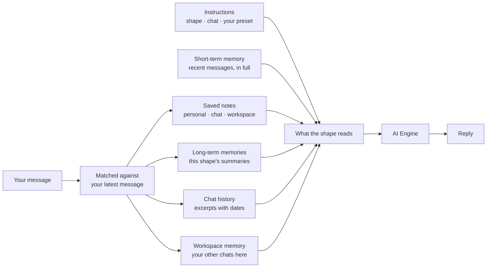
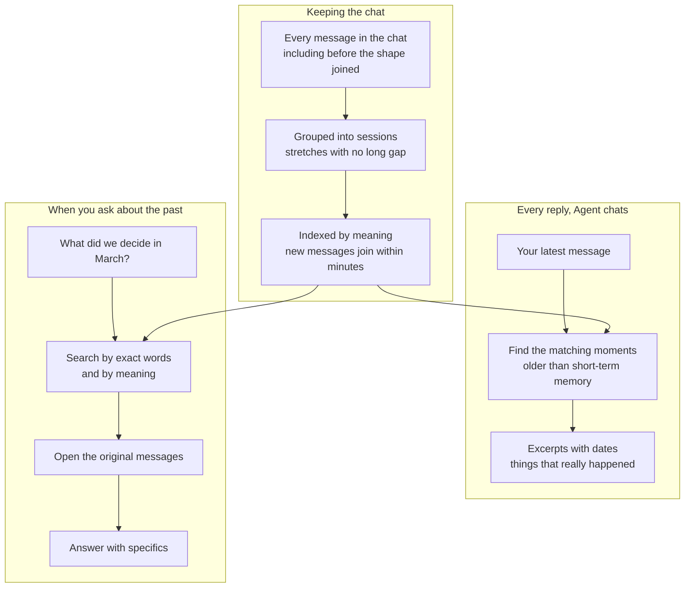
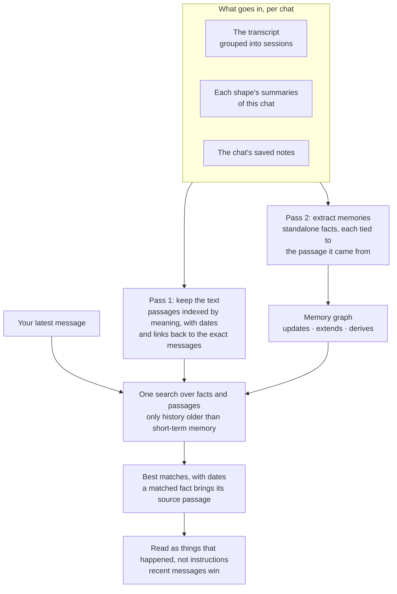
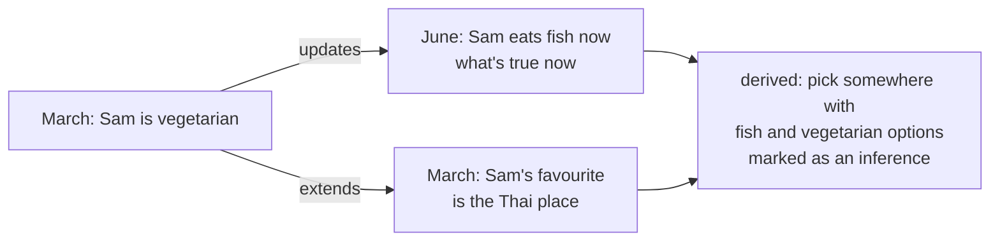
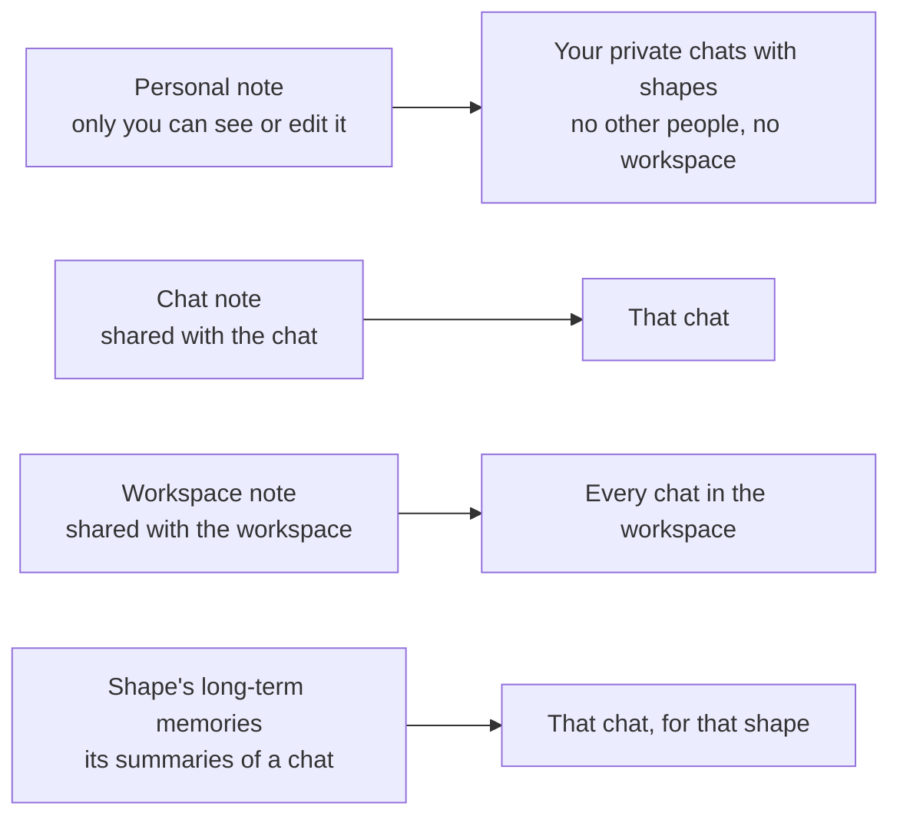
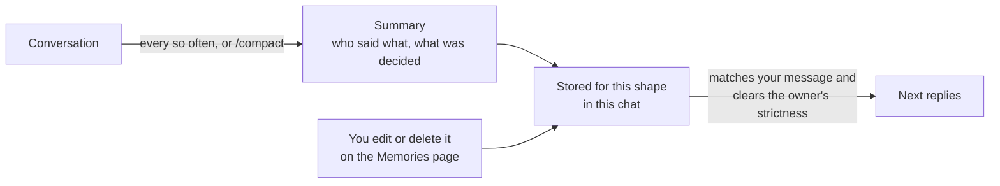
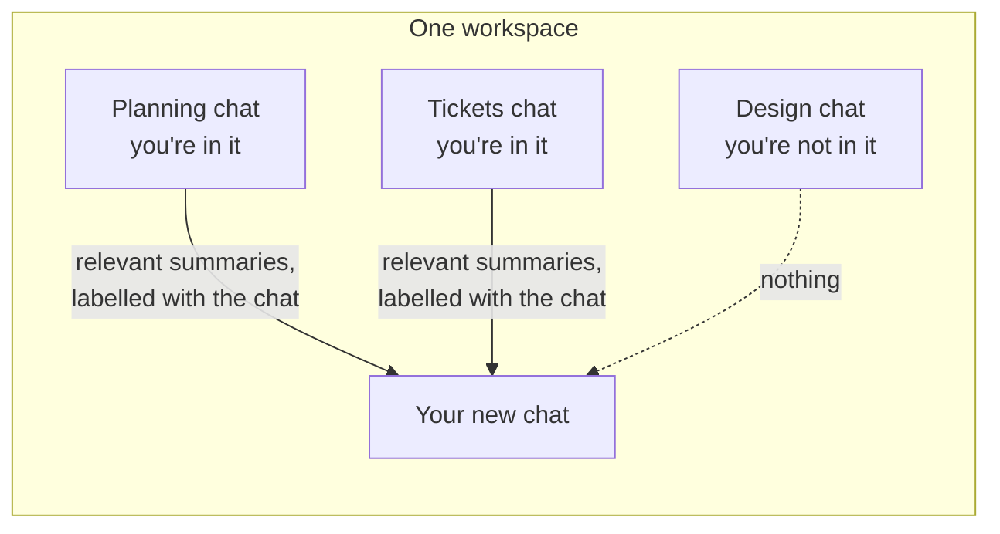
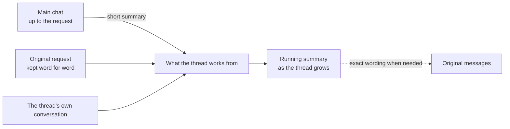

The [Memory Guide](/memory) tells you what a shape remembers. This page tells you how, in enough detail to work with it. Every layer below is retrieved, not read in full, and the thing it is retrieved *for* is almost always your latest message. Once you know that, most of the tips write themselves.

## What's different about it

Most assistants remember a conversation as a sliding window of recent messages plus a list of facts about you. A shape's memory is built for a chat that several people and several shapes share over months:

- **The whole chat, not a window.** In Agent chats, every message stays retrievable, by meaning, with the date it was said, including messages from before the shape joined.
- **Understood, not just stored.** Each chat's history is also distilled into standalone facts linked in a memory graph, where a newer fact updates an older one, so a shape knows what's true now and what used to be. See [inside the chat history engine](#inside-the-chat-history-engine).
- **Multiplayer.** Memory records who said what, so a shape can tell your preference from your friend's, and a chat note is shared with everyone in the chat on purpose.
- **Scoped.** Personal, chat, and workspace memory are separate, and you choose where a note goes.
- **Connected.** A chat in a workspace starts with background from your other chats in it, and a shape can search your other chats when you ask.
- **Verifiable.** Asked about the past, a shape finds the moment and opens the original messages before it answers, instead of guessing from a summary.
- **Bounded.** Nothing is recalled from a chat you aren't in, and recall never grants permission to act anywhere.

## How a reply is assembled

When you send a message, the shape builds its reply from these pieces, in roughly this order:

1. **Instructions**: the shape's profile and response style, the chat's custom instructions, and your personal preset. Always included, every reply.
2. **Short-term memory**: the most recent messages in the chat, read in full. How many depends on the shape owner's setting and your plan.
3. **Saved notes**: the handful of notes that best match your message, from the scopes that apply here (workspace, this chat, and personal in a private chat).
4. **Long-term memories**: the summaries this shape wrote about this chat that best match your message, up to the owner's limit and strictness.
5. **Chat history** (Agent chats): excerpts of the conversation itself that match your message, only from before the short-term window, with the dates they were said.
6. **Workspace memory** (Agent chats in a workspace): a few summaries from your other chats in the workspace that match your message.

Steps 3 to 6 run at the same time, each with its own small time budget, and a layer that doesn't answer in time is left out rather than delaying the reply. Recent messages win when a recalled detail disagrees with them.

<Info>
  The lookups are ranked against your **latest message**, not the whole conversation. A short "yes" or "what about that one?" pulls in almost nothing. A message that names the thing pulls in the right history.
</Info>

## Each layer, and how to work with it

### Chat history

**What it is.** In Agent chats, the whole conversation is kept searchable: the first time a shape replies in a chat, the chat's history is loaded (tens of thousands of messages in a very long chat), and new messages join it within minutes of being sent. The history is grouped into sessions, stretches of conversation with no long gap, so a decision and the discussion around it are stored together.

**How it is retrieved.** Your message is matched against the history by meaning, so "the hotel we liked" finds the conversation about the hotel even if nobody wrote "liked". The shape receives the best-matching excerpts, each with its date, and is told to treat them as things that really happened, not as instructions. Only history older than short-term memory is retrieved; recent messages are already there in full.

**In Agent chats, the shape can also search on request.** When you ask about the past, it searches by exact words and by meaning, gets pointers to the moments that matched, and opens the original messages before answering. Searching is the same whether it's you asking or the shape deciding it needs to check.

**Tips**

- **Name things.** "The Lisbon hotel", "Sam's budget", "the March plan". Names, places, and specific nouns are what matching keys on. Pronouns and "that thing" retrieve poorly.
- **State decisions in one clear message.** "Decided: Friday 7pm at Nando's, six people, Sam vegetarian." A decision spread across ten half-messages comes back in pieces.
- **Lead with the point.** For a long message, the opening lines are what later searches match best. Put the facts first, the backstory after.
- **Ask the shape to restate results.** A shape's own long replies are kept in shortened form, and what it *did* during an action is remembered through what it *said* about it. "Summarize what you found in three lines" makes that part of the record.
- **Keep one topic per sitting when you can.** Topics that run together in one stretch retrieve together. A pause, or a plain "new topic:", makes a cleaner boundary.
- **If it seems to have forgotten, ask again.** The history lookup has a time budget and is skipped on a slow reply rather than holding it up. Asking again usually brings it back, and "check the earlier messages" makes the shape search on purpose.

#### Inside the chat history engine

Chat history is not a search box over old messages. Each chat gets its own sealed memory engine, and everything that goes in is processed twice.

**Pass 1 keeps the text.** The conversation is grouped into sessions, each session is split into passages, and every passage is indexed by meaning with its date and a link back to the exact messages. This is what lets a shape open the original message instead of paraphrasing it.

**Pass 2 extracts memories.** From each session the engine writes short, standalone facts: "Sam is vegetarian", "the group picked May 12 for the trip", "Priya runs the budget". Pronouns and "that place" are resolved against the surrounding conversation, so each fact makes sense on its own, and each fact stays tied to the passage it came from as evidence. Extraction runs as soon as new messages arrive, not hours later. The engine is kept in step with the chat too: when a message is deleted or edited, or someone is banned from the chat, the passages and the facts drawn from them are forgotten, within minutes for a deletion and within a day otherwise.

**Facts live in a memory graph, not a pile.** Each new fact is linked to the facts it touches:

- A fact that **changes** an earlier one updates it: the newest statement wins for what's true now, and the older one stays as history, so the shape can say "Sam used to be vegetarian" rather than mixing the two.
- A fact that **adds detail** extends an earlier one; both stay true.
- The engine can **derive** a fact from several others. Derived facts are marked as inferences, so a shape treats them as a reasonable guess, not a quote.

**One search covers three sources.** Your message is matched against facts and passages together, over the transcript, every shape's long-term summaries of the chat, and the chat's saved notes at once, so a note and the conversation that led to it come back side by side. A matched fact brings its source passage along as evidence. In Agent chats, asking about the past also runs an exact-word search over the messages themselves, next to the meaning search.

**Tuned on real chats, not demos.** Before this shipped, every option was replayed against real conversations from shapes.inc with questions whose answers were known: how many matches to include, whether to re-rank them, whether to rewrite the query, whether facts alone or passages alone did better, and how to word the header the shape reads. The plain match over facts and passages, filtered to history older than short-term memory, was the most faithful to what was actually said, so that is what runs.

### Saved notes

**What they are.** Notes you or a shape saved on purpose, in three scopes. Personal notes apply in your private chats with shapes, where there are no other people and no workspace. Chat notes apply in that chat. Workspace notes apply in every chat in the workspace.

**How they are retrieved.** The notes that best match your message are included, a handful at a time. Scopes are checked together, workspace first, then chat, then personal. Notes are exact text: the shape reads your wording, not a paraphrase.

**Tips**

- **One fact per note, with its names.** "Sam (Priya's partner) is vegetarian" is matched by messages about Sam, Priya, food, or booking. One long note holding ten facts matches none of them well.
- **Write rules with the words that will trigger them.** A note is retrieved when your message resembles it. "When filing a ticket, put it in Planned, not Triage" surfaces when someone talks about tickets. "Planned not Triage" on its own rarely does.
- **Rules that must apply every single time belong in instructions, not memory.** Memory is retrieved when relevant; the chat's [custom instructions](/custominstructions-chats) are read on every reply. "Always answer in Spanish" or "never book without asking" goes in instructions.
- **Prune.** Only the best few matches make it into a reply, so a stale or duplicate note can crowd out the one you need. Open **Settings → Memories**, or ask the shape to delete it.
- **Say where it goes.** "Remember this for the workspace" versus "remember this just for me". In a group chat, notes go to the chat unless you say otherwise.

### Long-term memories

**What they are.** Every so often, each shape writes a summary of the latest stretch of conversation in a chat: who said what, what was decided, what mattered. The summaries are written from the conversation text, not from the details of actions, with one exception: a purchase is recorded only when it actually went through.

**How they are retrieved.** The summaries that best match your message are included, up to the owner's **Memories per reply**, and only when they clear the owner's **Match strictness**. They are per shape and per chat: a shape's summaries from one chat don't show up in another, except through workspace memory.

**Tips for everyone**

- **`/compact` at a natural break.** It writes a summary of the recent conversation right now, instead of waiting for the next scheduled pass. Good before a long pause or a change of subject.
- **Correct the summary, not just the shape.** If a summary got something wrong, edit it on the **Memories** page under **Conversation summaries**. A correction said in chat wins for a while; the edited summary wins for good.

**Tips for shape owners** (**Settings → Your shapes → the shape → Memory**)

- **Instructions that ask for names and decisions.** Memories written as "Alex prefers the window seat; the group chose May 12" retrieve far better than "the group discussed travel preferences". The sample instructions in the [Memory Guide](/memory#shape-memory-settings) are a good start.
- **Fewer, stricter memories beat many loose ones.** A low **Match strictness** lets the full **Memories per reply** count through on every message, relevant or not, and loose memories dilute the reply. Raise strictness until off-topic memories stop appearing, then stop.
- **How often is a trade-off.** More frequent summaries capture more detail and cost more; less frequent ones compress more. Busy group chats usually want more frequent.
- **The memory engine matters less than the instructions.** Any capable engine writes good memories from good instructions. Spend your effort on the instructions.

### Workspace memory

**What it is.** In a workspace, an Agent chat also receives a few summaries from the other chats in that workspace that you are a member of, matched to your message, each labelled with the chat it came from. Only chats you are in count: a workspace does not open its other chats to you or to the shape.

**Tips**

- **Open with the project or tool by name.** The first message of a new workspace chat is what the first lookup is matched against. "Set up the launch checklist for Orbit, same conventions as the Orbit planning chat" brings the right background with it.
- **Give chats descriptive titles.** Workspace memories name their chat, and you can point a shape at a chat by title: "check what the linear tix chat decided".
- **Put team rules in workspace notes.** A convention that applies across chats belongs in a workspace note, not a chat note in the chat where it happened to come up.

### Threads

**What a thread works from.** Its original request, kept word for word; a short summary of the main chat up to that point; and the thread's own conversation. As a long thread grows, a running summary keeps earlier decisions and finished work in view, and the shape can go back to the original messages for exact wording or the details of an earlier result without redoing it.

**Tips**

- **Make the first message the full brief.** It is preserved verbatim for the whole thread; everything else is summarized over time.
- **Bring changes into the thread.** Later messages in the main chat are not added to a thread on their own.

### Short-term memory

**What it is.** The last N messages, read in full. In Agent chats, actions and their results no longer push conversation out of this window.

**Tips**

- **With whole-chat recall, you need less of it.** Short-term memory is for the current exchange; older detail comes back through history when it's relevant.
- **`/wack` and `/clear` reset only this layer.** Use them to start a fresh exchange without losing anything the shape can recall.

## In a group

- **Who said what is kept.** History excerpts and summaries record the sender, so a shape can tell your preference from someone else's. Speak for yourself; let people state their own constraints.
- **The shape remembers the group, not a person.** Chat notes and summaries belong to the chat. A personal note never appears in a group chat, so keep private details in personal notes or private chats.
- **A shape added later can catch up.** Chat history covers the whole chat, including before the shape joined. A person added later sees replies from then on.
- **Corrections are public.** Correcting a shape in the chat updates the record for everyone. Editing a note changes future replies but not what was already said; post the change too.

## Engines and memory

Recall gets the right history in front of the shape; the AI Engine decides what to do with it. Stronger engines are better at picking the right detail out of several excerpts and worse at echoing the question back. If memory matters in a chat, choose a stronger engine in the chat's **Settings → Engines**, or for a shape you own under **AI Engine**.

## What memory is not

- **Not a transcript on demand.** A shape retrieves what matches your message; it doesn't re-read the whole chat each time. Ask it to search when you want certainty.
- **Not a permission.** Recalling something from another chat never lets a shape act there, and a shape only ever recalls from chats you are in.
- **Not perfect.** More context means occasional misreads. Recent messages win over old ones, so a correction in the chat is the fix.

[Back to the Memory Guide](/memory)
