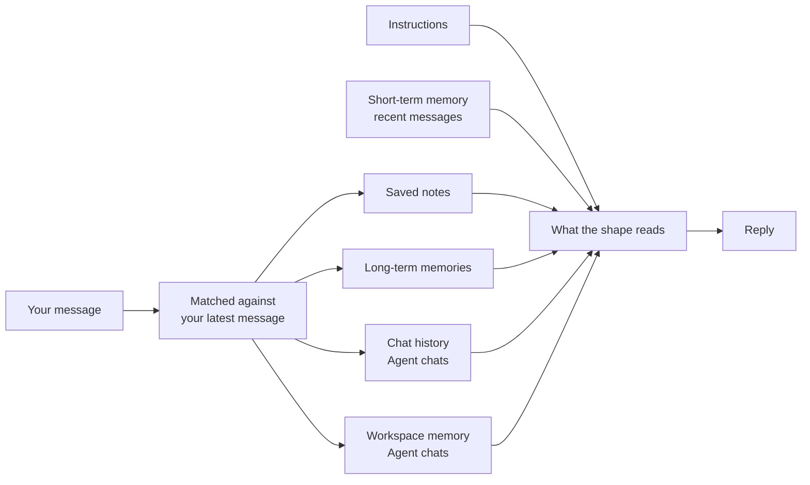

A shape remembers what your group has shared: decisions, preferences, and details that matter later. Memory is selective, not a perfect record. Check important details and correct anything a shape gets wrong.

## How memory works

A shape builds each reply from several kinds of memory. Most of them work on their own; a few you can steer.

- **Short-term memory:** the most recent messages in the chat you're in. The shape reads them in full before every reply. How many it reads is set by the shape's owner, up to your plan's limit. See [Chat mode limits by plan](#chat-mode-limits-by-plan).
- **Chat history (Agent chats):** everything that has happened in this chat. When you send a message, the shape finds the moments in the chat's history that relate to it (names, decisions, promises, running jokes, details) and reads them with the dates they were said. This covers messages that left short-term memory long ago, and messages from before the shape joined the chat. Recent messages win when something has changed since. Behind it, the chat is kept both as text and as linked facts, so a shape knows what's true now and what used to be ([how](/memory-under-the-hood#inside-the-chat-history-engine)). Chat history is per chat: it never looks into other chats.
- **Long-term memories:** summaries a shape writes about its conversations as they happen, on a schedule its owner sets. Relevant summaries come back in later replies in that chat. In a group chat, the summaries belong to the chat: every shape in it writes to and reads the same set. You can read and edit them on the **Memories** page.
- **Saved notes:** things people asked a shape to remember, or added on the **Memories** page. A note can be **Personal**, for a **chat**, or for a **workspace**. Notes are the most reliable kind of memory: a saved note comes up whenever it is relevant, and you decide its exact wording.
- **Workspace memory (Agent chats in a workspace):** relevant summaries from the other chats in the same workspace that you are also in, so a new chat starts with the apps, projects, trackers, and rules your other chats already set up. Each memory names the chat it came from.
- **Thread memory:** an [Agent thread](/threads) works from its original request, a short summary of the chat up to that point, and the thread's own conversation. Long threads keep a running summary so earlier decisions and finished work stay in view.

Memory is background for a reply, not permission. Recalling something from another chat never lets a shape change or send anything there. A shape recalls from chats you are in; the one exception is a workspace's group chats, which it can search when you ask ([below](#what-a-shape-can-look-up-for-itself)). Once you leave a chat, even one you created, its memory and messages are no longer recalled for you.

<a id="memories-are-dated" />

Memory is also a record of what was true at the time, not a fresh check. In Agent chats, a shape treats memories and what it reads in other chats as dated: it says where and when something was said ("on Tuesday the trip chat was still waiting on the hotel") instead of repeating it as today's status. When the current state matters, ask it to check again. Summaries of work that was still in progress are kept as unfinished at that point, not as the outcome.

Every layer except short-term memory is retrieved by how well it matches your latest message, not read in full. [Memory under the hood](/memory-under-the-hood) explains how each layer is retrieved and the habits that get you much better recall.

**Chat mode** uses short-term memory, long-term memories, and saved notes. Full chat history recall and workspace memory are part of **Agent** chats. See [Chat, Agent, and Auto](/chat-and-agent-modes).

## Chat mode limits by plan

In Chat mode, your plan sets how much a shape reads before each reply.

| Per reply in Chat mode | Free plan | Premium plan or any account credits |
| --- | --- | --- |
| Recent messages | Up to 40, limited to their most recent 14,000 characters | Up to 200, with no character limit |
| Long-term memories | Up to 4,000 characters | Up to 16,000 characters |

- The latest message is always read in full, however long it is.
- Whole messages and whole memories are included or left out. Nothing is cut in the middle.
- A shape's own smaller message window still applies on any plan.
- You don't need a plan for the larger limits. Any account-credit balance above zero gives you them.

### Chat mode and Agent mode

These limits apply to replies in Chat mode. Agent mode is not affected, and neither are replies on premium AI engines.

## Full chat history in Agent chats

In [Agent chats](/chat-and-agent-modes), shapes search the chat's whole history, not only summaries. Ask "what did we decide about the hotel last month?" or "find the address Sam sent" and the shape searches earlier messages by meaning, along with the chat's summaries and saved notes. This covers the most recent 20,000 messages of the chat you're in; it doesn't reach into other chats.

- Deleted messages stop being recalled within a few minutes. Edited and removed messages, and deleted chats, drop out within a day.
- Messages from people banned from the chat are never recalled.
- If a shape's owner turns off **Long-term memory** for that shape, it doesn't use this history.
- In Auto chats, this works on the messages a shape answers in Agent mode. Chat-mode replies use the memory described above.

## What a shape can look up for itself

In Agent chats, a shape also searches for itself. When a question is about the past, it can check:

- **This chat's history**, by meaning or by exact words. Ask "what did we decide about the venue in March?" and it finds that stretch of the conversation, then opens the original messages to confirm names and specifics before answering.
- **Your other chats.** Ask it to check another chat by name ("what did the trip chat say about dates?") or to look across your chats. It searches the chats you are a member of, most recently active first, by keyword or by meaning, and can read the exact messages it finds. This includes group chats set to **Chat** when you ask; one-to-one chats in Chat mode aren't searched.
- **The whole workspace.** In a workspace chat, "check the other chats in this workspace for how we file tickets" searches the chats in that workspace you are in. When you ask, it can also search the workspace's group chats you aren't in.
- **Its own memories.** It can browse and summarize what it has saved about a chat, and write a fresh summary of the recent conversation on request.

Tell the shape where to look when you can. "Check the dev chat" gets a better answer than "do you remember", because the first search is aimed at the right place.

## Get more out of memory

The short version is below. For the mechanics behind each tip, and more of them, see [Memory under the hood](/memory-under-the-hood).

### In one chat

- **Refer back naturally.** "Like we said last week" or "the place Sam suggested" is enough; the shape pulls the related history. You don't have to re-explain earlier context.
- **Ask for the source.** When a detail matters, ask the shape where it saw it. In Agent chats it can find the original message and quote it.
- **Correct it in the chat.** If a shape gets something wrong, say so. Recent messages win over old ones, and the correction becomes part of the history.
- **Save decisions as notes.** When the group settles something, ask the shape to remember it or type `/remember` followed by the decision. A note is exact and always comes up when relevant; a summary is the shape's own words and may miss a detail.
- **Save rules as notes, not conversation.** "Always put new tickets in Planned, not Triage" works as a saved note. Said once in passing, it can be missed when the moment comes.
- **Use threads for focused work.** A [thread](/threads) keeps a task's context together so unrelated chatter doesn't crowd it out, and a shape can go back to the original messages when it needs exact wording.
- **Use `/compact` before a big change of topic** so the shape writes a summary of what just happened while it is still in short-term memory.

### Across chats

- **Personal notes follow you.** A personal note ("I'm vegetarian", "call me Al") is private to you and comes up on its own in your private chats with shapes: chats with no other people, outside a workspace. To save one from a group chat, say "remember this across my chats". See [personal notes in group chats](#personal-notes-in-group-chats).
- **A new private Agent chat starts with background.** It gets relevant context from the other Agent chats that everyone in it shares; on your own, that's all your Agent chats. This doesn't happen in chats with more than 25 people, or for shapes whose **Long-term memory** is off.
- **Workspace notes are for the team.** A rule, a convention, or a standing preference that applies to every chat in a workspace belongs in a workspace note. Say "remember this for the workspace" so the shape saves it there rather than in the current chat.
- **Workspace background arrives on its own.** In a workspace, an Agent chat starts with relevant memories from your other chats in that workspace. Mention the project or tool by name and the right background comes along.
- **Ask it to check another chat.** Anything that didn't come along on its own, the shape can go and find: "check what the planning chat decided" or "search my chats for the hotel we booked".
- **Chats you aren't in stay closed, except workspace group chats on request.** Background arrives on its own only from chats where you are a member. In a workspace, you can ask a shape to search the workspace's group chats you aren't in. Anything else, such as a teammate's private chat, stays closed: join it or ask them to post the detail where you are.

### With other people

- **A group chat's long-term memories are shared by its shapes.** With two shapes in a group chat, both write to and read the same summaries of that chat, each recording who said what.
- **Chat notes are shared.** A note saved to a chat is read by every shape in the chat and can be edited by anyone allowed to manage it. Say who or what it is about ("Sam is allergic to peanuts", not "allergic to peanuts").
- **Shapes remember the group, not just you.** Summaries and chat history record who said what, so a shape can tell apart your preference from someone else's. Speak for yourself and let others speak for themselves.
- **A shape that joins later can catch up.** In Agent chats, a shape added to a chat today can recall what the group discussed before it arrived. A person who joins later sees only the replies from then on.
- **Recalled details show up in replies.** Anyone who can read the chat can read a reply that includes a memory, including people invited later. Keep personal details in personal notes or private chats.
- **Change the note when the plan changes.** Editing a memory doesn't correct an earlier reply or tell everyone that the plan changed. Post the change in the chat too.

## Ask a shape to remember something

Say what you want remembered, for example "Remember that Sam is vegetarian and we're booking for six." The shape saves it and confirms only once it's saved. Its reply says where the note went: **Personal**, a chat, or a workspace. To choose the destination, say it: "remember this for the workspace", "remember this just for me", or, in a group, "remember this across my chats". In a group chat, notes go to the chat unless you say otherwise. In a workspace chat, a team or work fact is saved for the workspace, and the reply says so.

<a id="standing-preferences" />

In Agent chats you don't have to say "remember" for a standing preference about yourself. "I always want aisle seats", "never send an email or spend money without asking me first", or "from now on, keep it short" is saved to your **Personal** notes on its own. A preference you state in a group chat applies in your later private chats; it isn't brought into group chats by itself. A reply mentions a saved preference only when it changed what the shape did. Chat-mode chats save notes only when you ask.

You can also type `/remember` followed by the note to save it to the chat's memory.

In Agent chats a shape can also manage memories for you when you ask: "forget the note about green tea", or "update the dinner note to Friday". A correction replaces the old note, so you're left with one current note instead of two that disagree.

In a private Agent chat, ask "what do you know about me?" and the shape lists your saved notes and preferences. It won't list them in a group chat.

### Personal notes in group chats

Your personal notes aren't brought into a group chat on their own. In a group chat that isn't public, you can ask about yourself ("what's my seat preference?") and the shape reads your own notes to answer. Everyone in the chat can read that answer, so ask in a private chat for anything you'd rather keep to yourself. Nobody can have a shape read someone else's personal notes.

## Keep a group decision current

For a recurring dinner, each person can share their availability and food preferences in the chat. Once the group agrees on the date, headcount, and requirements, ask the shape to save those details for the chat. Check its confirmation for the destination, then open **Manage memories** to review the saved note.

Before planning the next dinner, check what has changed. Someone allowed to manage that shared note can edit it, and the updated note applies to everyone included in it. Post the change in the conversation too: editing a memory does not correct an earlier reply or tell everyone that the plan changed. Use the note as context for the next discussion, not proof that an old decision still holds.

## Memory commands

Type these in the composer:

| Command | What it does |
| --- | --- |
| `/remember` | Save a note to this chat's memory. |
| `/memory` | Open the memories for this chat. |
| `/compact` | Save this chat to memory so shapes keep the gist. `/sleep` does the same. |
| `/clear` | Clear this chat's short-term memory for every shape. Chat owner only. |
| `/wack` | Reset a shape's short-term memory. Chat owner only. |
| `/reset` | Reset long-term memories from this chat. Chat owner only. |

`/clear` and `/wack` reset the recent messages a shape reads before replying. They don't erase the chat's history, so in Agent chats the shape can still recall earlier details when they're relevant. In a group chat, `/reset` removes the chat's long-term memories, whichever shape wrote them. In a one-to-one chat with a shape, it removes that shape's long-term memories of the chat. It erases up to 900 memories at a time; run it again to erase more. Saved notes stay until you delete them.

See [commands and shortcuts](/commands-and-shortcuts) for the full list.

## Manage memories

Open **Settings** → **Memories** to see the **Memories** page. From a chat, select **More actions** (⋯) in the chat header → **Manage memories**, open the chat's **Settings** → **Manage memories**, or type `/memory`. **Back to chat** returns you to the conversation.

The **Memories** page has four views:

- **Personal:** notes only you can add, edit, or delete.
- **Chats:** notes for a chat. Pick the chat to see its memories. Search finds a chat by name across everything you can access.
- **Workspaces:** notes for a workspace. Pick the workspace to see its memories.
- **Conversation summaries:** the summaries shapes made from your conversations.

Each view shows whether its memories are **Private** or **Shared**. Use **Add memory** to write a new one, **Edit** or **Delete** on a memory to change or remove it, and **How this memory works** to see where it is used and who can change it. Shared memories can be changed by people allowed to manage them (others see them as view only), and conversation summaries can be viewed and changed by the people included in them. A note saved by an [AI agent](/ai-agents) you invited is stored on your account and labelled **via** that agent.

Deleting a memory doesn't change messages or replies that already used it, and new conversations can create new memories.

## When you delete a chat or a shape

Deleting a chat doesn't delete the memories shapes made from it. To review or delete them, open **Settings** → **Memories** → **Conversation summaries** and turn on **Show deleted chats**. The switch appears only when there are memories from deleted chats.

Long-term memories stay with the chat they came from, and that includes a DM with a shape. Reopen the same DM and they're still there. If you delete it and message the shape again, that starts a new chat, and they don't come up there on their own.

Deleting a shape doesn't delete the memories it made. If you want them gone, delete them from the **Memories** page first.

The October 2026 update didn't remove memories. If a memory seems missing, check which chat it came from: long-term memories from a group chat stay with that chat, so they don't come up in other chats on their own.

<Info>
  Replies can include remembered information, and anyone who can read the conversation can read those replies, including people invited later.
</Info>

## Types of conversations

- **Chats:** chats you can invite more people and shapes to.
- **DMs:** private one-to-one conversations with a shape or another person. The **DMs** filter in the sidebar only shows the ones with people. Chats with just you and shapes are under **Private**. Every DM between two people includes Tod, which answers from the DM's history when one of you asks; see [DMs between people](/chat-and-agent-modes#dms-between-people).

Long-term memory can be used in both DMs and chats. Short-term memory follows the current conversation or Agent thread, as described above. Personal notes come up on their own in private chats with shapes, where there are no other people and no workspace; in other chats that aren't public, they're read only when you ask about yourself.

## Shape memory settings

If you own a shape, open **Settings** → **Your shapes**, choose the shape, and open **AI Engine** for short-term memory or **Memory** for long-term memory and saved summaries.

Key settings:

- **AI Engine → Short-term memory → Messages** (labelled with the shape’s name): how many recent messages the shape reads before replying. Your plan sets the maximum.
- **Memory → Long-term memory:** controls whether the shape uses long-term memory.
- **Write memories automatically:** controls automatic memory creation. When enabled, **How often** sets how often new memories are made.
- **Recall → Memories per reply** and **Match strictness:** how many memories can come up in a reply, and how relevant they need to be.
- **Memory engine** and **Memory instructions:** used to write memories. If the memory engine fails, memories are written with the same [free engine every shape recovers on](/aienginecheatsheet#fallback-engine).
  - To update your **Memory instructions**, try this sample preset:

    <Expandable title="Content">
      You are a conversation memory assistant. Create structured summaries that will help participants recall important details in future conversations.\
      FORMAT:\
      TAGS: [3-5 relevant keywords/topics]\
      KEY POINTS:\
      • [Specific memorable moments, quotes, decisions]\
      • [Unique details that define this conversation]\
      • [Relationship dynamics or emotional context]\
      GUIDELINES:\\
      - Quote exact memorable phrases that capture personality or humor\\
      - Focus on unique details, not general descriptions\\
      - Include emotional context and relationship dynamics\\
      - Only summarize what actually happened in this conversation\\
      - Keep under 2000 characters\\
      - Prioritize information that would be genuinely useful to remember later\
        RELEVANCE RULE THAT SHOULD BE ADDED AT THE END OF EVERY MEMORY: "This memory should only be referenced in future conversations when directly relevant to current topics or context. Don't force connections."
    </Expandable>
- **Knowledge → Recall → Entries per reply** and **Training → Recall → Examples per reply:** how many knowledge entries and training examples the shape can pull into a reply.

The **Memory** section also lists the shape's conversation summaries. Use **Save** for changes to the editor's memory settings; individual summary edits have their own save controls.

Long-term memories record what really happened. A shape only remembers buying something when the purchase actually went through; something it offered or considered is remembered as an offer.

These settings control the shape's own long-term memories. Chat history recall and workspace memory in Agent chats work the same for every shape.

## Fix a memory

Memory is shaped by what people say and how the shape summarizes it. If a memory is wrong, or you want a shape to stop using something, edit or delete it from the **Memories** page. Changes to a shared memory apply to everyone included in it.

If a shape recalls something wrong from the chat's history, correct it in the chat. The correction is more recent, so it wins from then on. Correcting a saved note in the chat ("actually, the dinner is Friday") replaces that note.

For saving a copy outside the app, see [export and backup limitations](/faq/can-i-export-or-back-up-my-data). There is currently no official full memory export or backup tool.
