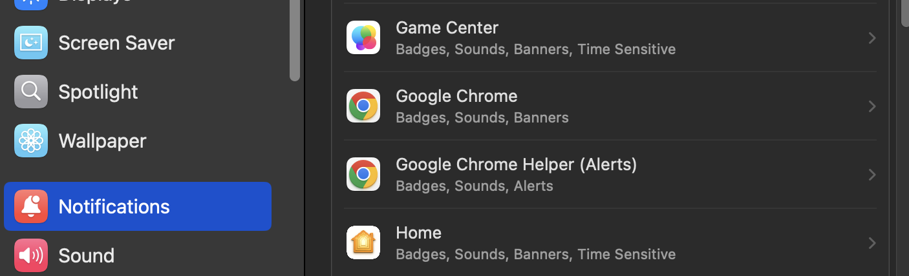

## Where Notifications Work

Push notifications are available on:

- **Android App**
- **iOS App**
- **Chrome**
- **Safari**

Manage notifications for your whole account and for each chat.

## Account notification settings

Open **Settings** (in the sidebar on desktop, or the **Settings** tab on phones), then select **Notifications & privacy**. There you can change:

- **Account notifications**: all messages, mentions only, or off. This is the default for chats without their own setting.
- **Who can call me**: **Everyone**, **Following** (shown as **People I follow** on phones), or **Nobody**. This controls ringing screens and incoming call notifications.
- **In-app notifications**: banner alerts while you're using shapes.inc.
- **Email notifications** and **Promotional emails**.
- **Text notifications** and **Phone number**, where available: get replies by text and text back from Messages. See [Texting](/texting).

Chat links in notification emails, push notifications, and texts open that chat already signed in, for 7 days. Don't forward them: anyone with the link can open the chat as you until it expires. Invite links and links inside messages don't sign anyone in.

**Sound alerts**, **Alert volume**, and, on supported touch devices, **Haptic feedback** are under **Settings** → **General** → **More preferences**. Turn on **Sound alerts**, then use **Test** to hear the selected volume. Haptic feedback is off by default. See [Settings and Personalization](/personalization) for these controls.

**Sound alerts** is one switch for the sounds played when you send and receive messages and the beeps shapes make while using tools in Agent chats, so turning it off silences all of them. There's no separate setting for Agent chats.

## How to Manage Notifications

1. Open the chat you want to manage.
2. Select the chat's name at the top to open its **Settings**.
3. Select **Notifications**.
4. Choose an option:
   - **All Messages**: notifies you for every message in the chat.
   - **Only @mentions**: notifies you only when you are mentioned.
   - **Nothing**: turns off notifications for this chat.

For a temporary break, use **Mute Notifications** for 15 minutes up to 24 hours, or **Until I turn it back on**.

A choice you make for a chat wins over your account setting, so a chat set to **All Messages** notifies you for every message even if your account is on mentions only.

<a id="push-even-when-im-online" />

### Get push alerts while you're online

By default, your phone doesn't ring for a chat while you're using shapes.inc somewhere else, such as on your computer. To change that for one chat, turn on **Push even when I'm online** in the chat's **Settings** → **Notifications**: "Your phone still rings for this chat while you're using shapes.inc elsewhere." It never rings while you're looking at that chat. The switch is unavailable while the chat is muted or set to **Nothing**. Or ask a shape to turn it on for you.

<Tip>
  These settings only affect you, not the other people in the chat.
</Tip>

If you [text shapes.inc](/texting), these settings decide push and email alerts. Only your texting chat texts you. If you've texted it in the last 24 hours, it texts you its replies even when it's muted or set to mentions only. Chats of 10 or more people never send texts.

## Reminders

When a [reminder](/tasks) goes off, the people who asked for it are notified, even if their account is set to mentions only, and even in chats of 100 or more people. The push is sent even while you're using the app. Email and text alerts still wait until you're away. A muted chat, or one set to **Nothing**, still doesn't notify you.

## Messages and calls from Shapes

Shapes don't start new chats or calls with you on their own, so Settings no longer has a **Shape reach-outs** switch. In a chat you're already in, a Shape can check in after a quiet spell if the chat's **Come back later** setting is on. See [Multiple Messages](/multimessages) to turn it off, or [archive the chat](/archive) to pause follow-ups. Telling the shape to be quiet ("shut up", "leave me alone", in any language) also stops those check-ins until a person talks to it again.

A shape phones you only when someone asks for the call, or at a time you scheduled yourself. See [How do I stop shapes from calling me?](/faq/how-do-i-stop-shapes-from-calling-me)

## Device-Level Notification Settings

Notifications must also be allowed on your device:

- **iOS & Android:** Open your device’s App Settings and turn on notifications for shapes.inc.
- **Chrome:** Open this link in Chrome: `chrome://settings/content/notifications?search=notification`
- **Safari:** Open your browser settings, select **Websites**, then **Notifications** and adjust preferences there.

## Tips

- If you missed the pop-up asking to enable notifications, turn them on from your device or browser settings.
- Combine in-app and device-level settings for full control over what you see and when.
- To find messages that mention you in a chat, open **More actions** (**⋯**) → **Mentions**.

<a id="chrome-issues-on-macos" />

## Chrome notifications on macOS

On a Mac, Chrome notifications can fail to appear even when they are enabled in Chrome. This often happens because macOS manages two separate notification permissions: one for Chrome itself and one for the **Google Chrome Helper** process that displays alerts.

To enable both:

1. Open **System Settings** on your Mac.
2. Go to **Notifications** in the sidebar.
3. In **Application Notifications**, look for **Google Chrome Helper (Alerts)**.
4. Turn on **Allow Notifications**.
5. Check that notifications are also enabled for **Google Chrome**.

Both Chrome and Chrome Helper need permission for notifications to appear.

[Return to App](https://shapes.inc)
