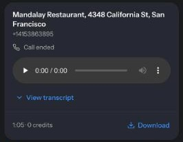
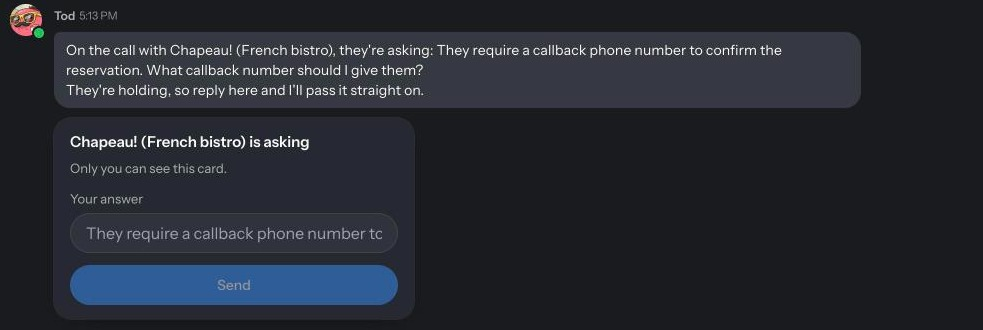

Some things still need a phone call: a table that isn't bookable online, a store's stock, a waitlist, a question only the front desk can answer. In an [Agent chat](/chat-and-agent-modes), ask a shape to make the call. It phones, talks to whoever answers, checks with you if they ask something it doesn't know, and posts the result in the chat for everyone.

You can also [call Tod](#call-tod) at the shapes.inc number from your phone, or ask a shape to call you.

To talk with a shape in the app, start a [voice call](/voicecalls) in the chat instead. A phone call is a call to or from a real phone number.

## What people ask for

Ask the way you'd text a friend who's making the call for you:

- **Get a table:** "can u call the thai place on valencia and book 4 at 7 tonight. anything 6:30 to 8 works, take the closest", "if they won't take a booking, ask how long the wait usually is and if they can put us on a list".
- **Book an appointment:** "get me a haircut tomorrow afternoon", "book a cleaning at my dentist next week, mornings only".
- **Ask what isn't online:** "can u call and ask if they do podi idli", "how long is the wait right now", "do they take walk-ins?".
- **Sort something out by phone:** "call the front desk and ask them to bring my packages up", "call the hotel and ask if we can check in early".
- **Call you:** "call me and do a mock interview for my barista job". The shape rings the number saved on your account: the one you text it from, verified, signed in with, or saved in [Saved details](/saved-details). If none is saved, it asks for your number once and keeps it in Saved details. You can also say "call me at" with a number. The call happens right away. A shape can't call you later at a set time, so it can't be a wake-up call. On the call, the shape can do things for you too; see [on a call with you](#on-a-call-with-you).
- **Call a friend:** "call noorie and ask if she's coming tonight", "ring @dhruvy about the tickets". The shape rings a friend on shapes.inc at the number saved on their account. You don't need to know it, and it's never shown in the chat. It tells your friend who asked it to call.

"If they need anything else from me, ask me during the call" works too: see [answer questions during the call](#answer-questions-during-the-call).

## Ask for a call

Say who to call, why, and what the shape is allowed to agree to. Give the number if you have it; otherwise the shape uses one it already knows, or finds the business's number on its official website.

> Call Lucia's at +1 415 555 0134 and ask for a table for 6 on Friday at 7:30. Anything between 7 and 8:30 is fine. Book it under my name.

> Call the hardware store on Main Street and ask if they have the 12-foot extension ladder in stock today.

When the request is clear, the shape calls right away. It asks first only if something it needs is missing.

- Calls work in Agent chats, for signed-in people. They don't run in Chat mode, and reminders or scheduled tasks can't place them. Ask in the chat, [by text](/texting), or on a call with the shape.
- A friend can be called by name or @username when you share a chat with them on shapes.inc and they have a number saved. Their number stays private.
- Type or say the ask. Choosing an option on a card doesn't start a call.
- The phone line calls US and Canada numbers (+1) only.
- It can't call emergency numbers. In an emergency, call them yourself.

## Follow the call

A call card appears on your message and updates live:

| Status | What's happening |
|---|---|
| **Waiting for your details** | The shape needs something before dialing. See [details for the call](#details-for-the-call). |
| **Preparing call**, **Starting call**, **Ringing** | The call is being placed |
| **On the call** | Connected. The card shows the last few lines of the conversation. |
| **Waiting for your answer** | They asked something the shape needs you to answer |
| **Ending call**, **Preparing recording** | The call is wrapping up and the recording is on its way |
| **Call ended** | Finished. The recording and transcript are on the card. |
| **Call failed** or **Call cancelled** | It didn't connect, or it was stopped. The card says why, such as "No one picked up" or "The line was busy". |

Under the title, the card shows the number and the caller's voice, such as **Voice: Cedar**. A number you asked it to call for yourself or a friend is shown masked.

Only the person who asked for the call can select **End call**.

## Answer questions during the call

If the other side asks something the shape can't answer, like "Is indoor seating okay?", the shape posts the question in the chat with a card titled **… is asking**. Type in **Your answer** and send. Only you see the answer box, and your answer goes straight into the call.

While you answer, the shape keeps the other side company on the line. After about 50 seconds it asks whether they can hang on. If you haven't answered after about a minute and a half, it thanks them, says it'll call back, and ends the call. It never guesses an answer for you.

The more you put in the first message, the less anyone waits on hold. "Around 7, anything 6:30 to 8 is fine" lets the shape say yes on the spot; "7" alone means it has to come back to you.

## Details for the call

The shape can give your name, phone number, and email from [Saved details](/saved-details) without them appearing in the chat. If one is missing, the card shows **Waiting for your details** and a private card asks for it. Send it there: it's saved for next time and the call starts. The request expires after 24 hours.

## After the call

The shape posts a short recap. On the call card, select **View transcript** to read the whole call, or **Download** to save the recording. Everyone in the chat can play the recording and read the transcript.

A finished call isn't proof the task is done. Read the recap to see what was actually agreed, such as whether the table is booked or only waitlisted.

The transcript is made from the recording, so it includes what the other side said even when the caller didn't catch it on a bad line. When that happens, the recap says what they said that the caller missed. The transcript is automatic speech recognition and can mishear names, numbers, and times. Play the recording before relying on anything important.

## Call Tod

Call the shapes.inc number you text, or call back the number a shape called you from. Tod picks up.

- **From a number on your account**, Tod knows it's you: one you text from, signed in or verified with, or one a shape has called you on. After a moment, Tod greets you by name ("Hey Sam, it's Tod. What's up?") and you lead. The call goes to your [texting chat](/texting#which-chat-a-text-goes-to), the same chat your texts go to. If you don't have one yet, a new chat with Tod called **Phone call** starts and becomes your texting chat. A call to shapes.inc never lands in a group chat.
- **From a number shapes.inc doesn't know**, Tod picks up briefly and texts that number. Reply to the text to get a link to sign up or sign in. After that, calling or texting the number reaches you. If the text can't be sent, Tod points you to the shapes.inc app.
- **A business or person a shape called for you**, calling back within 14 days, reaches the chat that asked for the call. The shape takes their message and posts it there. Someone calling back can't ask the shape to do anything for you.

When you call, the chat shows a call card ("You called, so I picked up"). The recording, transcript, and Tod's recap land there when you hang up.

## On a call with you

When you call shapes.inc, or a shape calls you because you asked it to, the shape on the line is the same one you talk to in the app:

- **Ask for anything you'd ask in the chat:** what's in this chat, what was said in another chat, what it remembers, a web search, your [connected apps](/connected-apps), booking, buying, or calling someone else. It says "one sec", keeps you posted while it works, and tells you the answer.
- **The chat shows the work.** The shape's steps and reply appear in the chat, starting with what you asked on the call. The call card lists each request and where it stands: **Working on it**, **Waiting for you in the app**, **Done**, **Couldn't do it**, or **Continuing in the chat**.
- **"Wait" and "hold on" mean stay on the line.** If a request takes more than about a minute and a half, it asks once whether you'd rather hang on or get the answer later.
- **When it needs you in the app**, such as a private details card, a choice, a sign-in, or a payment, it tells you what to tap and holds for up to 5 minutes, checking in about once a minute. It never asks for card numbers, passwords, or codes out loud.
- **It remembers your earlier calls**, and the chat it's calling from.
- **If time runs out mid-request**, it stays on to finish and tell you, then says bye.
- **Anything you asked for that didn't get done** on the call, the shape does in the chat after you hang up.

<a id="if-you-dont-pick-up" />

### If you don't pick up

When a shape calls you and you don't pick up, or it reaches voicemail, it rings once more straight away. Phones on Do Not Disturb often silence a first call from a number and let a second one through within a few minutes: on iPhone this is **Allow Repeated Calls** in Focus settings; on Android, repeat callers in Do Not Disturb. The first card says **No answer. Ringing again now**. If neither ring is picked up, the shape says so once in the chat and asks when's a good time.

Calls to businesses and to friends aren't rung twice.

<a id="pick-the-callers-voice" />

## Pick the caller's voice

Each shape has a phone voice, chosen to fit it until someone picks one. To change it, ask in an Agent chat: "what voices can you use on the phone?" or "call again, but in a different voice". The shape posts a card of voices with a play button on each. Play a few and pick one.

| Voice | Sounds |
|---|---|
| **Marin** | A woman's voice, warm and clear |
| **Cedar** | A man's voice, warm and relaxed |
| **Coral** | A woman's voice, bright and upbeat |
| **Sage** | A woman's voice, soft and calm |
| **Ash** | A man's voice, deeper and steady |
| **Verse** | A man's voice, lively and expressive |
| **Alloy** | Neutral and even |

- "Use Marin" or "a woman's voice" works too.
- The pick is that shape's phone voice from then on, for every call it makes, for everyone who uses the shape. Tod's voice is also the one that answers when you call shapes.inc.
- On a call with Tod, ask "what voices have you got?" and pick one. It takes effect from the next call, not the one you're on.
- The call card names the voice under the number, such as **Voice: Cedar**.

## What the other side hears

The call comes from a shapes.inc number, not yours. The shape introduces itself by name and says it's an AI if asked. If nobody answers, it hangs up instead of leaving a voicemail. Calls are recorded.

- It waits for whoever picks up to speak first: "Hi, this is Tod, I'd like to book a table for two tonight around seven."
- It asks one thing at a time and waits for the answer.
- The voice is the shape's [phone voice](#pick-the-callers-voice).
- It doesn't bring up that it's an AI unless someone asks.
- A booking goes under the name in your Saved details. It never pretends to be you.
- On a call to a friend, it says who asked it to call.
- It can work through phone menus, but not every menu works.
- It leaves a short voicemail only if you ask it to, with the message you approve.
- If they call that number back within 14 days, the shape takes their message and posts it in the chat that asked for the call. To get more done, ask the shape to call them again.
- Calls are in English. The phone line calls US and Canada numbers (+1) only; for any other number, the shape says so before dialing and nothing is charged.

## In a group chat

Plan together, then let one person ask for the call. For a birthday dinner, everyone adds their dates and preferences, you [vote on a shortlist](/multiplayer-activities), and then whoever's booking asks the shape to call the winner. Everyone sees the call card, follows the call live, and can play the recording.

The person who asked for the call gets the private cards for missing details and questions during the call, is the only one who can end it, pays for it, and has the booking made under their saved name. A "call me" number is masked on the card, so the group doesn't see it.

## Cost and limits

| | Free | Premium |
|---|---|---|
| Calling | 100 free credits of calling a day, about 4 minutes. Resets at midnight UTC. When a call needs more time than you have left today and you have enough account credits, they pay for the whole call instead, at 22 credits a minute, billed by the second. | Pay per use from account credits: 22 credits a minute, billed by the second |

- Calls to businesses and friends last up to 3 minutes unless you ask for longer, up to 15 minutes. A call a shape places to you lasts up to 10 minutes unless you ask for a length. When you call shapes.inc, the call can last up to 15 minutes.
- On Free without enough account credits, or with account credits off for the chat, a call is shortened to the free time you have left today.
- When you call shapes.inc and neither your free time nor your credits can cover it, Tod still picks up for about a minute, free.
- Calls use your account credits only, not chat or shape credits. If account credits are turned off for the chat, the shape tells you.
- A call that doesn't connect, because it was busy, nobody answered, or it failed, costs nothing.
- The call card shows what the call used. A call paid from today's free time shows free credits, with a line for what's left. See [today's allowances](/credits#see-todays-allowances).
- Playing back a recording is free.
- One call at a time to the same number.

See [Credits](/credits) and [Premium](/premium-subscriptions).

## When a call doesn't work

- **No answer, busy, or voicemail:** the card shows **Call failed** with the reason, or **Call ended**. Ask again later, or ask the shape to try a different number from the business's website. A call to you rings twice before giving up; see [if you don't pick up](#if-you-dont-pick-up).
- **"Not confirmed whether this call started":** don't ask again right away. Check the card first; the shape won't redial on its own.
- **"Today's free calling time is used up":** you're on Free, today's free time is gone, and your account credits can't cover the call. A card under the reply offers credits or Premium. After you buy, ask for the call again: the card doesn't place it for you. Or wait until midnight UTC.
- **"The phone line only reaches US and Canada numbers":** the number is outside +1. No call was placed and nothing was charged.
- **No recap:** if the shape stays busy, it says so. The recording and transcript are still on the card.
- **The shape says it can't make phone calls:** the chat is in Chat mode, or you're signed out. Switch the chat to Agent; see [Chat, Agent, and Auto](/chat-and-agent-modes).
- **The shape asks for your number:** none is saved on your account yet. Send it in the chat: the shape calls it and keeps it in [Saved details](/saved-details), so "call me" works next time without it. Change it there any time.
- **The shape can't find your friend:** use their exact @username, for example "call @noorie". It only calls people you share a chat with on shapes.inc; if they have no number saved, give it in the chat.
- **The shape asks you to type the request:** you chose an option on a card. Type the ask, such as "call them".
- **A call to someone's own phone hit call screening or voicemail:** this is common, because the number is new to them. Tell them to expect the call, or ask the shape to leave a short message.
- **The recap says it's booked, but you're not sure:** play the recording and look for the time, the name, and any confirmation number.
- **You called shapes.inc and Tod didn't know you:** call from a number on your account, or reply to the text Tod sent you to sign up or sign in.
- **On a call, the shape says it can't do something you can do in the app:** ask again plainly, for example "look it up" or "check my email". Anything you asked for that didn't get done, it does in the chat after the call.
- **The recap says the caller missed something:** the other side spoke but the caller didn't hear it on the line. The transcript has what they said; play the recording to check.
